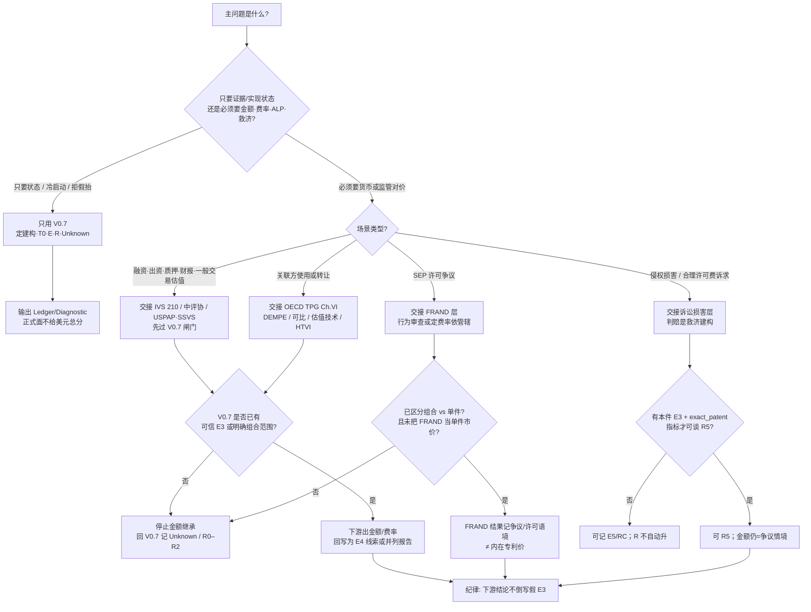

# T2 场景选用决策树：何时只用 V0.7，何时交接金额 / TP / FRAND / 判赔层

> Status: **research decision tree v0**（2026-10-14 Asia/Shanghai）  
> Track: **T2** · 承接 [`existing-models-comparison-matrix.md`](existing-models-comparison-matrix.md) · [`t2-v07-to-ivs-oecd-practice-schools.md`](t2-v07-to-ivs-oecd-practice-schools.md)（#67）  
> Formal: **V0.7** + **schema 1.0** · **未** adopt / freeze V0.8 · **不**输出美元总分  
> 本页是**选用导航**，不是合规意见、估值结论或诉讼策略。

## 0. 先记住三句

1. **几乎总是先跑 V0.7**（定建构、T0、E 级、R 阶、Unknown）——它是上游闸门，不是金额引擎。  
2. **交接 ≠ 替换**：下游给出费率/金额后，**不得**倒写假 E3，也**不得**把判赔自动抬成 R5（仍要本件 E3 + exact_patent 指标）。  
3. **一种场景可以多层并用**（例如：V0.7 记录映射 + 另请 IVS 出市场价值）；树问的是「主问题该交给谁」。

## 1. 场景速查表（中文优先）

| 你的主问题 | 先用 | 可交接（下游） | 仍停 V0.7 / 勿交接金额的情形 |
|---|---|---|---|
| 冷启动：这件专利有没有可核对的实现？ | **仅 V0.7** | — | 缺 E3 → 诚实 R0；引证/打分只做 Screening |
| 融资 / 出资 / 质押 / 财报：要**金额或价值类型** | V0.7 闸门 | **IVS 210** / 中评协指南 / USPAP·SSVS | 无件级映射却把产品收入当专利价值 |
| 关联方许可或转让定价：要 **ALP** | V0.7（公开侧） | **OECD TPG Ch.VI**（+ HTVI 如适用） | 用集团叙事代替 DEMPE/功能分析或代替 E3 |
| 普通许可谈判：要费率/一次性付款 | V0.7（E3/E4 线索） | **IVS / 可比许可 / 中评协许可目的评估** | 行业费率表直接定价本件 |
| SEP / 标准必要：要 **FRAND** 区间或行为判断 | V0.7（组合/件要分开记） | **FRAND 经济学 / 行为或定费率法域实务** | 把组合 FRAND 费率写成单件内在价格 |
| 侵权诉讼：要损害 / 合理许可费 / 禁令语境 | V0.7 +（研究层）RC | **诉讼损害 / 合理许可费裁判** | 判赔金额 = 资产市值；有判赔就自动 R5 |
| 政策 / 奖项 / 高价值库标签 | Track B 信号 | — | 当作通用经济价值或 R3+ |
| 早 T0 期权讲故事 | V0.7 停 R0/R1 | （可选）实物期权作**并列**研究，不回填 R | 用未来畅销倒推早年实现 |

## 2. Mermaid 决策树

## 3. 节点说明（简）

| 节点 | 含义 |
|---|---|
| **只用 V0.7** | 主交付是 Realization / Attribution / Observability；适合冷启动、holdout、拒假抬、内部质控。 |
| **交接 IVS 等** | 主交付是选定价值基础上的金额；V0.7 回答「钱能不能说到这件/这个包」。 |
| **交接 OECD TP** | 主交付是关联方 ALP；与 V0.7 平行，不互相替代。 |
| **交接 FRAND** | 主交付是标准必要组合下的公平合理无歧视条件；法域差异大（行为 vs 定费率）。 |
| **交接诉讼损害** | 主交付是救济；可喂 E4/E5/RC，但 **≠** 资产公允价值。 |

## 4. 反例（选用错误）

1. 产品热销 → 直接要 IVS 收益法估「该专利」→ **应先 V0.7 E3**。  
2. 有 FRAND 组合费率 → 写入单件 R5 → **建构偷换**。  
3. 有判赔 → 当作市值或自动 R5 → **缺 E3/指标则停**。  
4. 关联方合同有费率 → 跳过功能分析只抄费率 → **OECD 与 V0.7 双缺**。  
5. 引证分高 → 当 Proof 或直接交接金额 → **Screening≠Proof**。

## 5. 非目标

- **未** adopt V0.8；**不**改 schema 1.0；**不**编码新 ledger。  
- **不**替代持证评估、税务或法律意见。  
- 树可随法域实务更新；细节标准见 #67 备忘来源表。

## 指针

- 矩阵：[`existing-models-comparison-matrix.md`](existing-models-comparison-matrix.md)  
- #67 深化备忘：[`t2-v07-to-ivs-oecd-practice-schools.md`](t2-v07-to-ivs-oecd-practice-schools.md)  
- T1：[`t1-theory-memo-value-construct.md`](t1-theory-memo-value-construct.md)  
- Formal：[`model-v0.7.md`](model-v0.7.md) · [`evidence-levels.md`](evidence-levels.md)  
- 四轨：[`world-class-roadmap.md`](world-class-roadmap.md)
